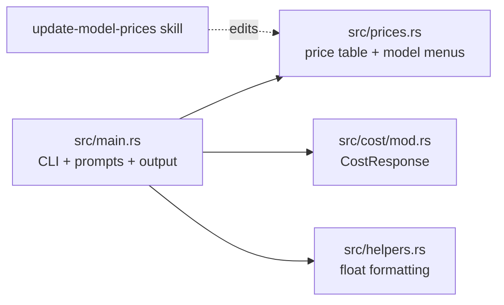
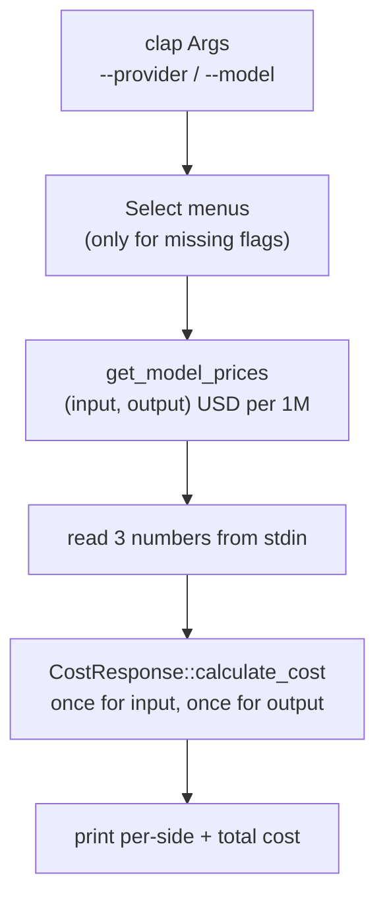

# Mental model: token_calculator

Read this before you edit the code. It explains how the CLI is put together and where the traps are. The model and price list lives in [README.md](../README.md). The price-refresh workflow lives in [.claude/skills/update-model-prices/SKILL.md](../.claude/skills/update-model-prices/SKILL.md).
_Last written: 2026-10-19 (v0.20.1, 40146f9)._

## 1. What the product is, in one breath

A small interactive Rust CLI (binary `calculator`). You pick an LLM provider and model, type an average prompt token count, an average completion token count and a number of requests, and it prints an estimated USD API spend. All prices are hard-coded in one source file, so a release is effectively a price-table snapshot.

## 2. The shape of the system

There are only four source files. No config files, network calls or persisted state exist, and the only dependencies are `clap` (flags), `inquire` (select menus) and `num-format` (thousands separators).

## 3. The core loop

1. `main` parses `--provider` / `--model`. Each one that's empty opens an `inquire::Select` menu, fed by `PROVIDERS` or `get_provider_models(provider)`.
2. `get_model_prices(provider, model)` dispatches to `get_<provider>_model_prices`, which returns `(input, output)` in **USD per 1M tokens**.
3. Three `stdin` lines are parsed as `i32`: average prompt tokens, average completion tokens and number of requests.
4. `calculate_cost(tokens, requests, price)` runs once per side, and the results are summed and printed. **This step is currently broken.** See trap 1 in §10.
5. A Perplexity add-on branch (`model.ends_with("online")`) adds per-request fees. No current model matches it, so it's dead code (trap 4).

## 4. Domain vocabulary

| Term | Meaning here |
|---|---|
| Provider | Lower-case key: `openai`, `google`, `perplexity`, `groq`, `anthropic` (`PROVIDERS`) |
| Model id | The provider's real API id (`claude-opus-5-5`, `openai/gpt-oss-120b`), used as the match key |
| Prompt / input tokens | Tokens sent per request ("prompt" in the UI) |
| Completion / output tokens | Tokens generated per request (spelled "completition" in the UI) |
| Tier entry | A second id with a suffix (`-200k`, `-272k`, `-100k`) holding the long-context price. Users pick it themselves, and nothing switches automatically by size |
| Fallback price | The `_ =>` arm in each provider fn, returned for any unknown model id |

## 5. Conventions

- **Each model appears twice in `src/prices.rs`:** once as a match arm in `get_<provider>_model_prices` and once in the `get_provider_models` vec, in the same order (newest/flagship first, tier entries right after their base). The test `test_every_listed_model_has_explicit_price` uses `include_str!("prices.rs")` to check that every menu entry has a `"id" => (` arm. **If you reformat the arms (e.g. rustfmt splits a line), that test breaks.**
- `test_listed_models_are_unique` guards against duplicate menu entries.
- Adding a provider takes four edits: the `PROVIDERS` array (bump its length `[&str; N]`), a new `get_<provider>_model_prices`, a dispatch arm in `get_model_prices`, and an arm in `get_provider_models`. Add a README section and a URL in `references/providers.md` too.
- Errors aren't handled. Every parse and prompt is `.unwrap()`, so bad input panics.
- The update-model-prices skill sets the rules for which models go in: no "contact sales" or limited-access models, Groq production models only, today's price when a promo is running. Follow the skill, not your own memory of prices.

## 6. Data model

The price table is the whole data model: `match` statements returning `(f32, f32)` tuples. `CostResponse { num_tokens: i32, cost: f32 }` is the only struct.

## 9. Running & shipping

| Task | Command / trigger |
|---|---|
| Run locally | `cargo run` or `cargo run -- --provider openai --model gpt-4.1` |
| Scripted smoke test | `printf '1000\n500\n1000\n' \| cargo run -q -- --provider anthropic --model claude-opus-5-5` |
| Tests | `cargo test` (unit tests sit inline in each module) |
| CI | `.github/workflows/rust.yml`: build + test on push/PR to `main` |
| Release | Push a `v*` tag. `release.yml` calls `build-artifacts.yml` (5 targets: Linux x86_64/ARM64, macOS ARM/Intel, Windows), adds `SHA256SUMS` and creates a GitHub release |

The version in `Cargo.toml` and the tag are bumped by hand, and so is the download example in the README (it hard-codes `v0.20.1`).

## 10. Invariants & traps (read before editing)

1. **The cost formula doesn't scale with token count.** `CostResponse::calculate_cost` (`src/cost/mod.rs:12`) returns the per-1M price as the cost whenever tokens are above zero. With Opus 5.5, 500 output tokens and 500,000 output tokens both print "20.00 USD". The code used to compute `num_tokens * pricing / 1_000_000`. Commit 5166f2a replaced that, and the tests in the same file now assert the wrong behaviour (`calculate_cost(100, 10, 0.5)` → `0.5`). Fixing it means updating those tests too.
2. **`i32` overflow panics.** `tokens * requests` (`src/cost/mod.rs:9`) panics in debug builds and wraps in release builds once the product passes about 2.1B. For example, 100k tokens × 30k requests panics with `attempt to multiply with overflow`.
3. **Unknown ids are silently priced at a fallback.** If you pass `--model` with a typo, the run carries on at that provider's `_ =>` price and prints no warning. An unknown `--provider` with `--model` falls to `(0.002, 0.008)` in `get_model_prices` (`src/prices.rs:106`), a stale per-1K-era value that's about 1000× too cheap. Without `--model`, an unknown provider gives an empty menu and the `unwrap` panics.
4. **The Perplexity "online" surcharge is dead and also wrong.** No model ends in `online`, so `src/main.rs:75-81` never runs. `get_perplexity_online_requests_cost` (`src/prices.rs:110`) also uses integer division, so it returns 0 below 200k requests.
5. **The variable names lie.** `_price_input_1k` / `_price_output_1k` (`src/main.rs:53`) hold per-**1M** prices. Don't use the names to work out the units.
6. **The tests are coupled to the source text.** See §5. Keep each price arm on one line, in the form `"id" => (in, out),`.
7. **Tier entries are user-selected.** Nothing compares the prompt size against the `-200k`/`-272k`/`-100k` thresholds. If you add auto-switching, the menu and README semantics change.
8. **Prices are a dated snapshot.** The README's "as of" line and `references/providers.md` "Last verified" should move together whenever `src/prices.rs` changes.
